# Ryde -  Carpool & Ride Booking App

Ryde is a Flutter passenger app that brings shared and private ride booking into one experience. Riders can choose their route, explore vehicle options, review driver offers, negotiate a fare, and follow their journey on a live map.

The carpool flow supports booking seats with drivers who have available capacity, including drivers already carrying passengers. Private rides offer an individual booking option with drivers who are not currently on a trip.

This repository contains the **passenger side of Ryde**. A connected driver app or backend supplies driver availability, responses, and live journey updates.

**Source availability:** this repository is intended as a selective source showcase. Core matching, pricing, negotiation, tracking, and wallet modules are excluded from the public source; the public checkout is intentionally incomplete and cannot build or run the full app as supplied. The features below describe the complete private implementation.

## Key Features

### Shared and Private Rides

Choose the type of journey that suits your needs:

| Shared Ride | Private Ride |
| --- | --- |
| Select seats for a shared journey | Request a private journey |
| Match with drivers who have enough available seats | Match with drivers who are not already on a trip |
| Can include drivers with an ongoing shared ride | Includes an optional date/time selector |
| Car, auto, and e-rickshaw options | Car, auto, bike, and e-rickshaw options |

**Book Any** lets the rider consider compatible vehicle options without choosing one specific type. The scheduling interface is present, but automatic dispatch at a future time is still being developed.

### Maps and Location Search

- Search for pickup and destination addresses.
- Use the current location to help set the pickup point.
- View the journey route and distance on the map.
- Select ride options through location, vehicle, and seat-selection sheets.

### Fare Estimates and Negotiation

Ryde estimates fares using the journey distance, vehicle category, city configuration, and shared/private ride choice. Pricing supports time-based inputs, including day/night rates.

Riders can review driver responses, accept an offer, or negotiate the price before confirming. The estimated fare and the agreed fare may differ, giving negotiation a distinct place in the booking experience.

### Driver Matching

The app considers whether drivers are online, their vehicle type, pickup proximity, and how recently their location was updated. Shared rides also consider seat availability, while private rides exclude drivers already on a trip.

Matching currently focuses on pickup distance and capacity. Checking route overlap and optimizing multiple passenger stops are areas for further development.

### Live Tracking and Ride Continuity

- Follow the driver's location and journey progress.
- Track pickup and destination phases of the ride.
- Open the phone dialer to contact the driver.
- Return to tracking through an active-ride banner while browsing the app.
- Resume an active ride after reopening Ryde.

### Accounts and Ride History

Email/password and Google sign-in flows support passenger accounts. Riders can manage profile details and review previous journeys, fares, and recorded payment statuses. The home screen also provides access to the latest ride information.

Wallet and chat screens are included in the app, with their current limitations described under [Project Status](#project-status).

## Passenger Workflow

### Getting Started

On launch, Ryde checks whether the rider is signed in and whether a ride is already active. New users see onboarding, returning users can sign in, and riders with an active journey can return directly to tracking.

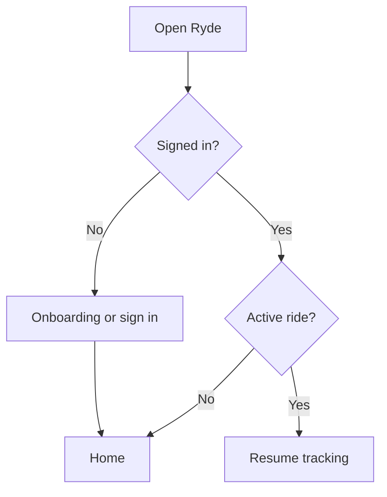

### Booking a Ride

1. **Choose your route:** Set pickup and destination locations using search or the map-based location flow.
2. **Select your ride:** Choose shared or private, pick a vehicle or Book Any, and select seats for a shared journey.
3. **Review the estimate:** Check the route, distance, and estimated fare before requesting a ride.
4. **Find a driver:** The app looks for eligible drivers and displays their responses as they arrive.
5. **Agree on a price:** Accept a driver offer or negotiate the fare.
6. **Follow the journey:** Track the driver and ride progress after confirmation.
7. **Review past trips:** Access journey information through ride history.

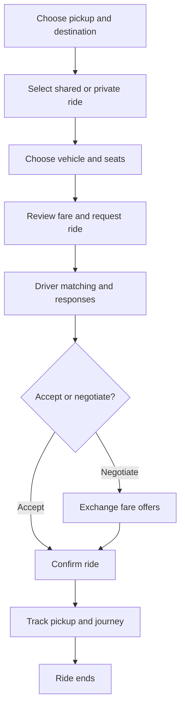

Requests can also end without a booking when no eligible drivers are available, the request expires, or the rider cancels.

## App Experience and Design

Ryde uses a light, map-focused interface with blue accents, white cards, rounded inputs, and clear booking actions. Bottom sheets keep location, vehicle, seat, and scheduling choices close to the booking screen.

The main navigation provides five areas:

| Area | Purpose |
| --- | --- |
| **Home** | Map, current location, booking entry point, and latest ride |
| **Ride History** | Previous journeys and fare details |
| **Wallet** | Balance and transaction records |
| **Chat** | Driver conversation interface, currently a prototype |
| **Profile** | Personal details and account management |

The persistent ride banner keeps an ongoing journey accessible while the rider explores other sections.

## Architecture Overview

Ryde separates the passenger interface, application state, and connected services. This helps organize features such as authentication, booking, fares, and tracking while allowing screens to react to incoming ride updates.

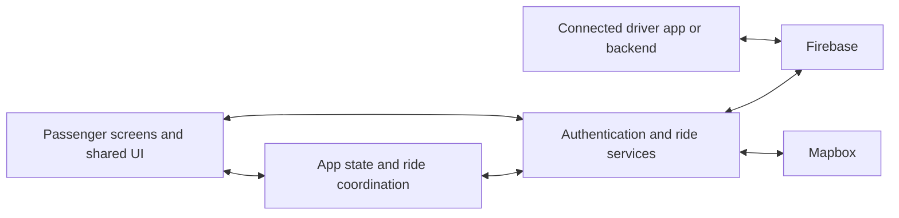

| Part | Role in the app |
| --- | --- |
| **Passenger interface** | Presents maps, booking choices, offers, tracking, and account screens |
| **Application state** | Keeps the signed-in user, location, active ride, fares, and wallet information available to the UI |
| **Service layer** | Coordinates account operations, ride requests, matching, negotiation, maps, and tracking |
| **Firebase** | Supports authentication, stored ride/account data, live updates, and messaging integration |
| **Mapbox** | Provides maps, place search, geocoding, and driving routes |
| **Driver integration** | Supplies driver availability, offers, and location updates through the connected system |

During booking, the passenger app creates a ride request and listens for responses. Once a driver is selected and a fare is agreed, live journey updates feed the tracking screen. Active-ride information allows the passenger to return to an ongoing trip later.

### Technology Summary

| Technology | Purpose |
| --- | --- |
| **Flutter and Dart** | App interface and application logic |
| **Provider** | Shared app state and screen updates |
| **Firebase Authentication** | Passenger sign-in and account access |
| **Cloud Firestore** | Profiles, requests, offers, history, wallet records, and fare settings |
| **Firebase Realtime Database** | Live driver and journey updates |
| **Firebase Cloud Messaging** | Push-notification integration, still being completed |
| **Mapbox** | Maps, address search, and route information |
| **Device location services** | Current position and location permissions |

##  App Screenshots

  
  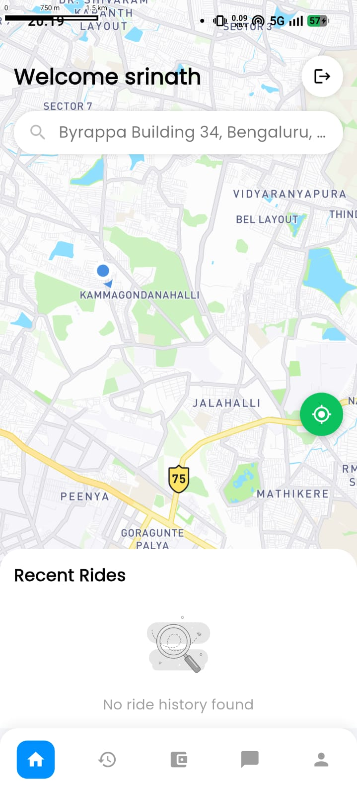
  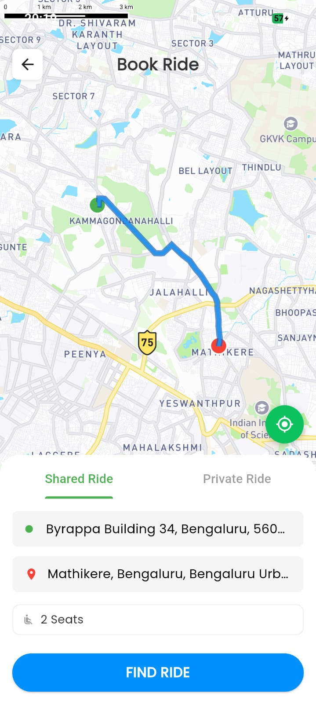
  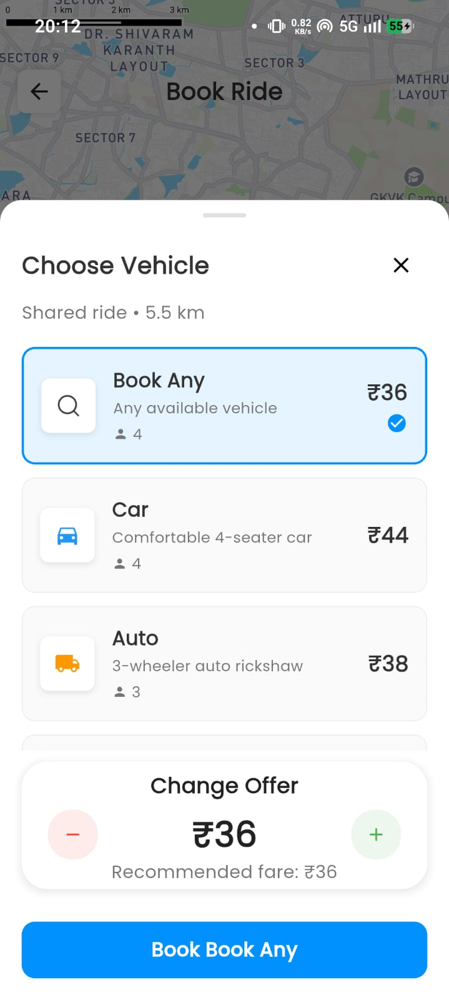
  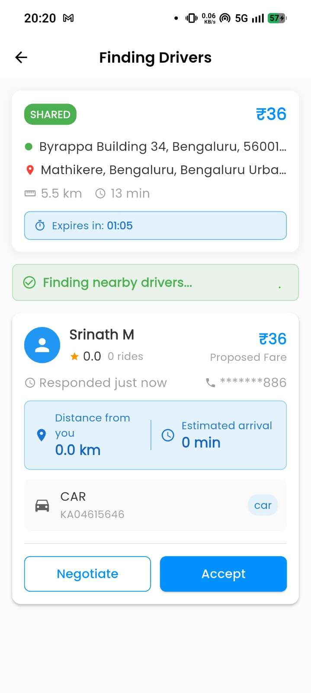
  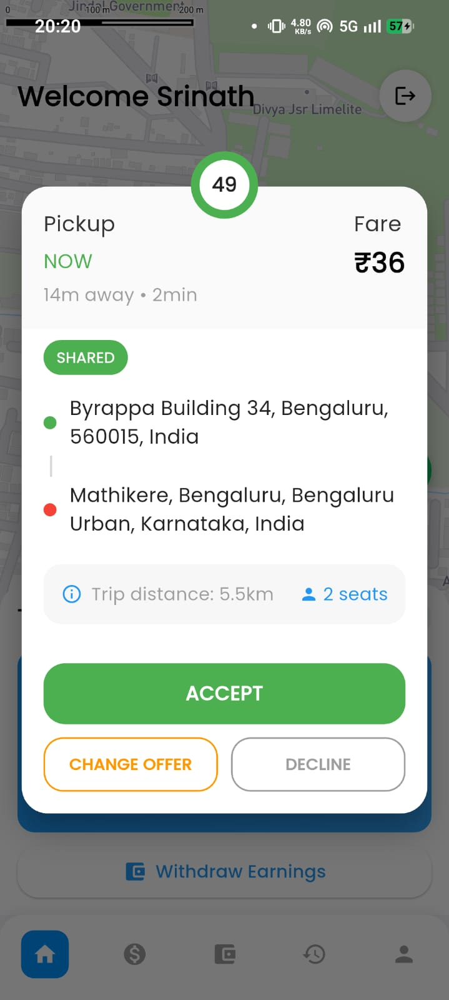
  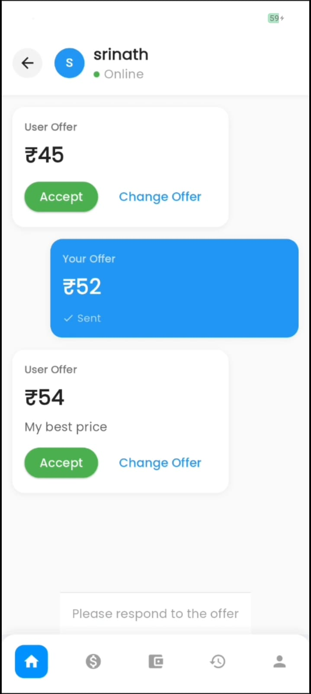
  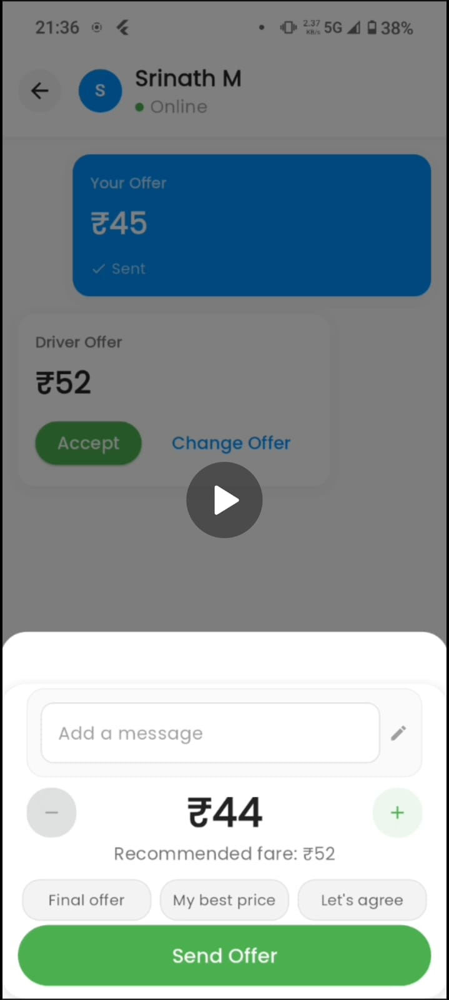
  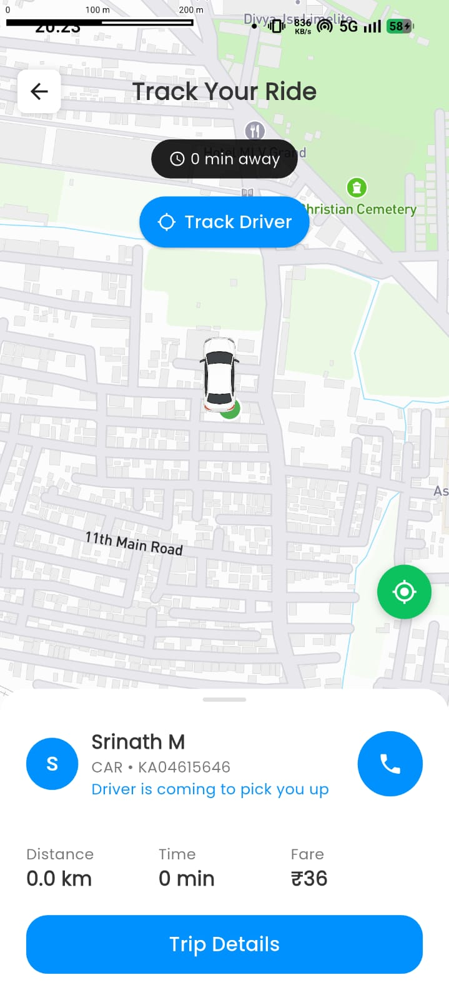
  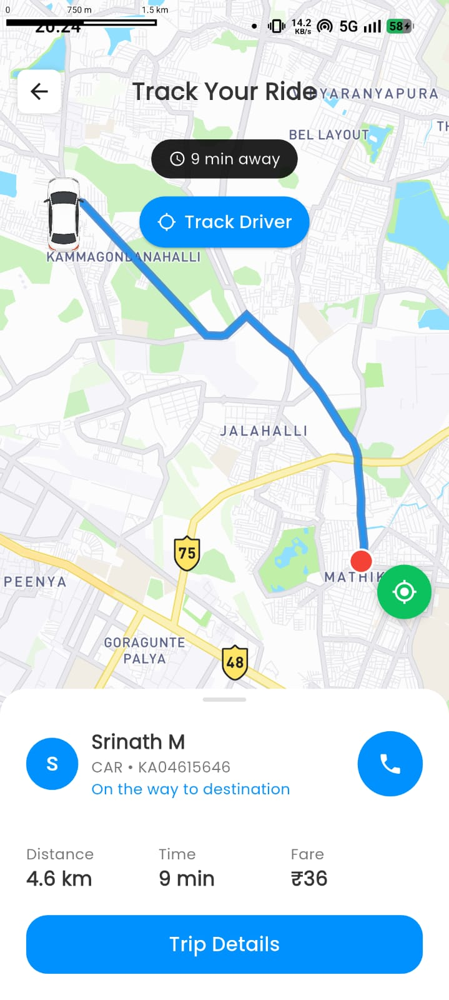
  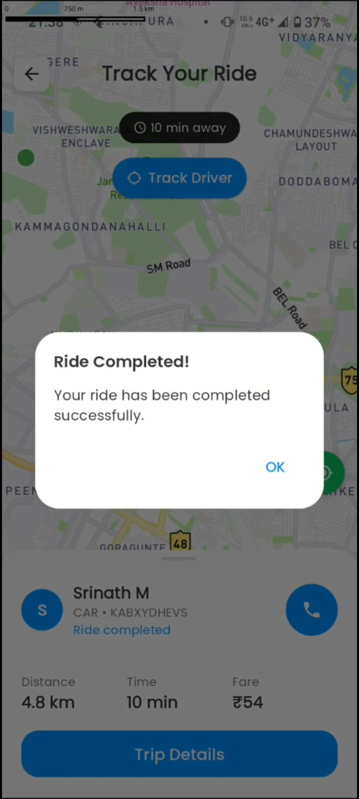

##  Ryde App Demo

<video width="600" controls>
  <source src="docs/recordings/Ryde_demo.mp4" type="video/mp4">
</video>

[Watch the Ryde demo](docs/recordings/Ryde_demo.mp4)
